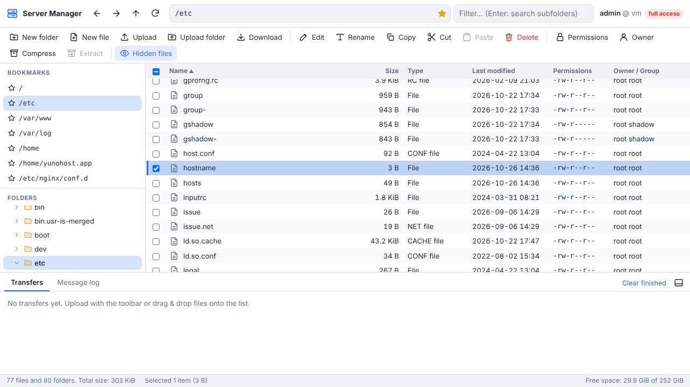

# Server Manager for YunoHost

A web file manager for your [YunoHost](https://yunohost.org) server. It does in the browser what you would otherwise do with an SFTP client like FileZilla: browse, upload, download, edit, move, copy, delete, change permissions and owners of your server's files.



## Features

- Folder tree, address bar, bookmarks, back/forward/up navigation, sortable columns (name, size, type, date, permissions, owner)
- Upload files and whole folders, with the toolbar or by drag & drop, in a transfer queue with progress, speed and an "already exists" prompt (overwrite / keep both / skip, for one file or the whole batch)
- Download files, and folders or multiple selections as a zip archive
- Built-in text editor for configuration files: line numbers, auto-indent, tab/shift-tab, Ctrl+S, warning if the file changed on the server meanwhile, and it keeps the encoding (UTF-8, UTF-8 with BOM, Latin-1), line endings (LF/CRLF), permissions and owner of the file
- New file / new folder, rename (F2), copy / cut / paste (Ctrl+C/X/V), move by drag & drop onto a folder, delete
- Change permissions with a FileZilla-like dialog (checkboxes or numeric value, recursive, files only / folders only) and change owner and group
- Compress to zip, extract zip / tar / tar.gz / tar.bz2 / tar.xz archives
- Filter the current folder as you type, press Enter to search all subfolders (wildcards like `*.conf` work)
- Image preview, right-click menus, keyboard shortcuts, light/dark theme, mobile friendly
- Audit log of every change, with the YunoHost user who made it

## Installation

```bash
sudo yunohost app install https://github.com/GZPlaz/server-manager_ynh
```

During installation you choose:

- **the URL** (default: `https://your.domain/files`),
- **the folder to manage**: `/` for the whole server, or a specific folder such as `/var/www`,
- **full access**: whether the app runs as `root` (needed to edit system files such as `/etc/...`) or as its own unprivileged system user.

Both can be changed later in the app's configuration panel.

To upgrade after pulling changes:

```bash
sudo yunohost app upgrade server-manager -u https://github.com/GZPlaz/server-manager_ynh --force
```

## Security

With full access, whoever can use this app effectively has root access to your server. Therefore:

- Only the `admins` group can access it after installation, and the permission is **protected**: it can't be opened to visitors (anonymous users).
- Authentication is done by the YunoHost SSO (SSOwat), which passes the logged-in user to the app. The app only listens on `127.0.0.1` and refuses requests without an authenticated user.
- Every request that changes something must carry a custom header and a same-origin `Origin`, which blocks cross-site request forgery.
- The browser UI runs under a strict Content-Security-Policy. Files are never served inline (except image previews, sandboxed), so a malicious HTML or SVG file can't run scripts in the app.
- Paths are normalized and confined to the managed folder, symlinks included.
- Essential system folders (`/etc`, `/usr`, `/var`, `/home`…) can't be deleted, renamed or moved.
- The systemd service drops every capability a file manager doesn't need, and a syscall filter blocks kernel module loading, mounting, rebooting, etc.
- Every change is logged in `/var/log/server-manager/server-manager.log` with the user who made it.

## How it works

- `sources/server.py`: the backend, a single file using only the Python standard library (no pip packages to install or keep up to date).
- `sources/static/`: the frontend, plain HTML/CSS/JavaScript without build step or external resources.
- `scripts/`, `conf/`, `manifest.toml`, `config_panel.toml`: the YunoHost packaging (packaging v2, helpers 2.1).

NGINX forwards `https://your.domain/files/*` to the app; SSOwat adds the `YNH_USER` header identifying the logged-in user.

## Development

Run the backend tests:

```bash
python3 -m unittest discover -s sources/tests -v
```

Run the app locally on a test folder (the `YNH_USER` header normally added by SSOwat must be supplied, e.g. with a browser extension or a reverse proxy):

```bash
SM_ROOT=/tmp/some-folder SM_PORT=8080 python3 sources/server.py
curl -H 'YNH_USER: me' http://127.0.0.1:8080/api/list?path=/
```

## License

MIT, see [LICENSE](LICENSE).
